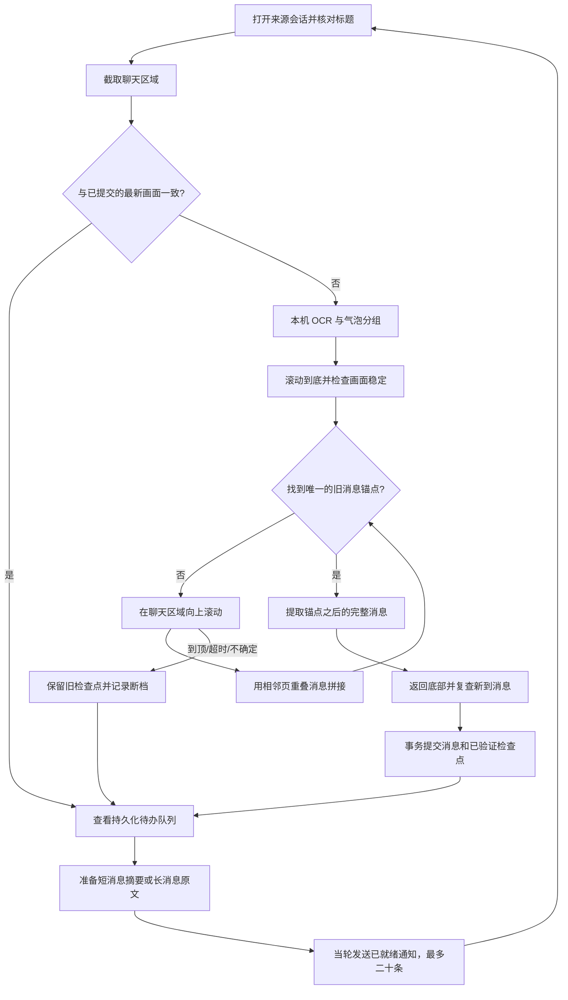

# 刷屏补采与消息转述 v1

目标：来源群在两次检查之间刷过多屏时，追溯到上次确认的位置，按原顺序补采，再通过独立队列总结和转述。不以缩短轮询时间替代补采，也不承诺纯视觉采集零遗漏。



## 采集与定位

- 配置窗口大小、聊天区域、滚轮步长、补采页数和时间预算。
- 首次运行先到底部建立基线，不转发旧消息。空群基线也保留检查点。
- 将发送者、方向、完整正文和完整性组成消息指纹；忽略 OCR 的换行和空格变化。保留原文，不修改实际转述内容。
- 桌面适配器用上次最后一条确认完整的消息正文和秒级时间作为锚点。时间通过点击气泡右侧留白读取。遇到早于锚点的时间就停止继续回翻；若旧正文和较新时间能共同确认边界，提交可验证的新增消息。
- 滚轮只放在聊天记录区域。每次滚动后重新截图、核对群标题和窗口状态，通过画面是否变化判断滚动效果。
- 某些客户端钳制滚轮参数，每个事件只移动约 41 像素。执行器匹配高对比文字区域的实际重叠像素，校准一次事件对应的像素数，再批量滚动至约 40% 屏高。每批预计不超过 40% 屏高，批末截图验证并更新校准。每次逻辑翻页有滚轮事件数上限。
- 向上逐页补采，使用“旧页尾部 = 新页头部”的唯一重叠拼接。允许重复消息分别入库；没有唯一重叠时停止并标记问题。
- 默认最多 30 次页面观察、45 秒；预算针对单次补采，不含打开软件和最初截图。单个底层截图/OCR调用不可抢占，因此实际耗时可能超过预算。
- 底部继续刷屏时，先提交已经证明连续的前缀，再在下一轮补齐新尾部；不会直接把锚点跳到尚未补齐的最新画面。

## 一致性与断档

消息与检查点在同一个 SQLite 事务中提交。失败时保留旧检查点，页面截图和识别结果独立保存，便于复查。`collection_gaps` 保存原因、首次/最近时间、重试次数和解决时间。

来源消息拥有持久化的 `continuity_verified` 字段。即使进程在“采集提交”和“转述排队”之间崩溃，下次也能从未推进的队列游标补入，不依赖当前画面的状态推断。

可能的断档原因包括：找不到旧锚点、滚到历史边界、相邻页没有唯一重叠、只有不完整消息、超过页数/时间/消息预算、补采期间最新尾部再次超出当前视野。已证实连续的消息可保存；未证明的部分不会伪装为完整。

## 总结与发送

### 一条消息超过聊天视口

气泡识别会保留上下边缘截断状态、左右位置、OCR 可靠性和发送者，不再直接丢弃被截断的文字。遇到缺少旧锚点的截断消息时，以保留重叠区域的小步滚动寻找完整头尾；同一气泡需方向一致、左右位置接近、发送者无冲突，并有至少两条可唯一定位的重叠文字行，才允许拼接。重复段落、没有足够重叠、OCR 不可靠或达到回翻预算时，保留原检查点并报告缺口，不发送半条正文。

完整消息保留片段截图引用并整体入库。相邻的两条长消息仍分别处理。首次观察建立基线。长正文一次粘贴，发送前根据长度读回全文或核对输入框截图；已部分发送的旧分段消息保留原进度。

当前限制为文本气泡、单条最多 10,000 字符，且受高级设置中的回翻页数和时间限制。图片、语音和跨页复杂卡片尚无完整拼接能力。

SQLite 队列负责衔接采集与模型：`pending → summarizing → draft → sending → sent`。

- 持续模式在同一轮完成采集、准备和发送，最多发送二十条。发送完成后回到来源群，只查看最后一条的时间并截图留存，正式锚点仍由采集流程更新。

- 当前画面已包含消息锚点和新消息时，直接持久化可验证的新增前缀，不先滚动。像素位移估计失败后仍读取实际画面，用 OCR 消息锚点证明页间连续性；不会把速度估算失败当成截图失败，也不放弃消息校验。
- 按 `--interval` 调度每轮开始时间，截图、OCR 和发送耗时计入间隔。超时则跳过错过的周期。
- 默认最多 10,000 条未完成转述任务。达到上限时不再推进该条来源消息的排队游标，原始消息仍保存在数据库；释放空间后继续排队，不静默丢弃。
- 失败摘要标记 `summary_failed`。重启可重新处理未完成的 `summarizing`；结果不确定的 `sending/unknown` 需要核对，其余待发消息可以继续。
- 文件锁阻止两个 relay 命令同时控制桌面。模型线程可以并行工作；多个鼠标执行器不能并行。

本机 OCR 与截图仍同步执行，正在采集时无法同时去接收群发送。持续高速刷屏、超长消息、图片、语音、自定义卡片、隐藏的发送者、重复内容和 OCR 错字仍需要进一步覆盖。

## 验证

自动化测试覆盖：1000 条突增消息的顺序和数量、补采期间追加消息、重复锚点、找不到锚点、预算耗尽、空群转为有消息、检查点持久化、重启不重复、采集与排队之间崩溃、队列背压，以及模型阻塞时仍能采集新消息。

真实桌面测试：

```powershell
$env:PYTHONPATH = 'src'
# 实际向配置的来源 Webhook 发 8 条多行模拟消息；不向接收群发送。
.\.venv\Scripts\python scripts/test_scroll_recovery.py --inject --count 8
# 若补采未完成，用原 manifest 重试采集，绝不重复注入。
.\.venv\Scripts\python scripts/test_scroll_recovery.py
```

测试使用独立数据库，记录每条消息唯一标记、Webhook 已接受列表、补采次数、页数、滚动次数、重复/漏采检查结果；记录在本地 `artifacts/scroll-test-manifest.json`。

### 像素校准与批量滚动

`scroll_mode="batch"` 为默认模式；设为 `"stepwise"` 可退回每次滚轮事件都验证的诊断模式。

1. 首次先发送一个滚轮事件，测量实际像素位移。
2. 用剩余目标距离除以校准步长，估算一批需要多少事件；每批预计移动不超过 40% 屏高。
3. 一批事件结束后等待平滑滚动稳定，再截图核对真实位移。使用真实重叠像素的模板匹配，避免重复排版让周期相关误配位移。
4. 距离不足则补滚；小于半个校准步长的差值不再追求，以避免为几像素多滚一个完整步长。
5. 实际速度改变时，缩小批次并重新校准。像素匹配低可信或存在并列匹配时，清除步长估计并停止本次补采，原消息检查点仍保留。

校准按客户端、群、区域、窗口位置/尺寸、DPI、方向和滚轮参数分别缓存，60 秒过期。到边界的短位移不能当作永久固定步长；后续操作仍有反馈校正。

当前客户端实测存在加速行为，所以默认 `scroll_batch_events=2`，而不是将整页所需的十余个事件一次性发出。批量上限可配置为 1～12；截图验证无法通过时会缩小后续批次，原采集检查点不前移。

`scrolling.py` 将控制算法与实际鼠标、截图分开。指标包括目标/实际像素、滚轮事件数、反馈截图数、批次数、重新校准次数及耗时；窗口层另记录全部截图数和 OCR 耗时，避免只统计内部控制循环而遗漏开销。

```powershell
# 使用原来已发送的刷屏测试消息做 A/B，不新增或转述消息。
.\.venv\Scripts\python scripts/benchmark_scrolling.py
```

基准从归档的相同旧锚点开始，使用独立数据库，核对每条测试编号恰好一次。`artifacts/scroll-benchmark-日期时间/report.json` 保存结果，包括失败尝试；不会改写正式采集检查点。

本机最终同版本 A/B 结果（2026-11-21，复用原有 8 条测试消息）：

| 指标 | 逐事件验证 | 校准批量滚动 |
|---|---:|---:|
| 完整采集且无重复 | 8/8 | 8/8 |
| 总耗时 | 66.145 秒 | 56.139 秒 |
| 全部截图次数 | 122 | 75 |
| 滚动反馈截图次数 | 92 | 45 |
| 滚轮事件数 | 83 | 67 |
| OCR 调用次数 | 30 | 30 |
| OCR 耗时 | 28.945 秒 | 28.442 秒 |

该单轮对比中总耗时减少约 15.1%，总截图减少约 38.5%。它证明本机该样本的改进，不代表其他软件、布局或持续负载下固定有相同比例。报告位于本地 `artifacts/scroll-benchmark-20261121-130523/report.json`。

过程中保留了失败的实验：大批次触发滚动加速，且重复排版可能让位移误配；曾出现截图数下降但总耗时反而增加的结果。最终采用每批最多 2 个事件、批末等待 0.20 秒、严格重叠像素匹配和反馈校准。像素不可信时停止，不能用速度预测代替消息连续性校验。当前 51 项单元测试通过，覆盖稳态、重复排版、边界、步长变化和校准过期等情况。

现场演示可以使用 `scripts/benchmark_scrolling.py --modes batch --attempts 3`，最多重试三次，全部尝试耗时计入报告。修复了校准失效时批次回退被立即过期的问题，保守批次现在会在下一次尝试中保留。一次现场重跑找回 8/8 条、无重复，10 页观察、9 次逻辑滚动、77 次截图，耗时 69.151 秒（其中 OCR 40.416 秒）；这也说明机器负载会影响总耗时，不能将前一次 56 秒视为固定延迟。现场报告在 `artifacts/scroll-benchmark-20261121-143440/report.json`。

### 本轮结果（2026-11-21）

- 单元测试：模拟一次突增 1000 条消息，按顺序完整补齐；慢模型不阻塞采集、进程中断与背压等用例一并通过。
- 实机首次尝试因客户端钳制滚轮步长耗尽 45 秒预算，未推进旧检查点，也未误报成功。
- 修正为测量实际位移后，使用同一批 8 条多行消息重试；在 120 秒测试预算内，用 10 次页面观察、9 次逻辑滚动恢复 8/8 条，每个编号出现一次。
- 再次只读采集返回 `unchanged`、新增 0、入队 0，8 个编号仍各出现一次。
- 本轮没有向接收群发送这 8 条测试消息，也没有启动常驻监控。测试数据库与常规转述数据库隔离。
- 本机来源目标已配置 60 页、120 秒补采预算。默认模板仍为保守的 30 页、45 秒，可按截图/OCR耗时调整。
