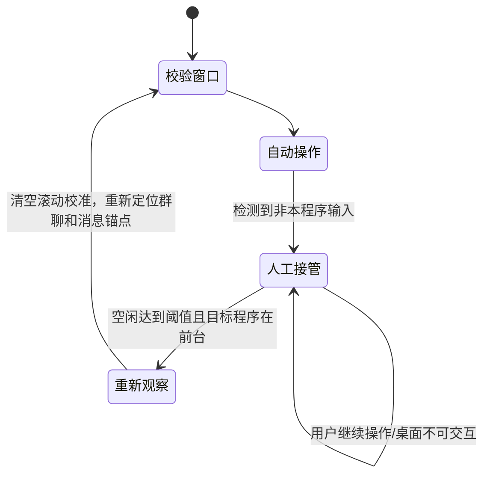

# 人工接管与桌面冲突处理

原则：用户输入优先。程序检测到用户使用鼠标、滚轮或键盘时暂停自动输入；恢复时重新确认界面，不继续使用被打断时的坐标或翻页序列。不禁用鼠标，不吞掉用户按键。



## 输入归属

程序在当前 Windows 会话安装被动的低级鼠标、键盘监听。自动输入统一经 `TaggedInputs` 的 `SendInput` 发出，在 `dwExtraInfo` 中携带本次进程的标记；只忽略这个标记，不简单地忽略所有 injected 输入。因此其他远程控制软件生成的输入也按外部接管处理。

监听器只保存活动类别、时间和代数，不保存按键值、文字或鼠标轨迹。只在内存中保留最后一个指针位置，以忽略远程桌面同位置、零位移的重复通知；实际移动一像素、按钮及滚轮仍触发接管。回调始终传递事件，不阻止用户输入，不修改业务应用内部。Windows 结构和标记机制参考 [MSLLHOOKSTRUCT](https://learn.microsoft.com/en-us/windows/win32/api/winuser/ns-winuser-msllhookstruct) 与 [KBDLLHOOKSTRUCT](https://learn.microsoft.com/en-us/windows/win32/api/winuser/ns-winuser-kbdllhookstruct)。

每次移动、点击、滚轮事件，以及输入每个 Unicode 字符前后，都检查监听状态和目标窗口焦点。检测到用户按住鼠标按钮或 Ctrl/Shift/Alt 时也拒绝继续注入。窗口或焦点发生变化时重新进入暂停；输入监听不可用则停止。Windows 拒绝读取鼠标位置或远程桌面不可交互时，暂停而不是继续尝试点击。

## 恢复条件

目标配置：

```toml
human_idle_seconds = 5
resume_requires_target_foreground = true
```

默认用户持续空闲 5 秒，且已回到目标应用前台，才允许自动恢复。用户在其他软件中停下来阅读，也不会仅因为空闲 5 秒就被抢回焦点。首次启动仍会等待已有输入活动结束，再执行显式请求的打开动作。

恢复只让主循环重新进入 `ensure_app → 核对程序路径/窗口 → 核对群标题 → 截图 → 锚点补采`。原动作栈已经退出，滚动校准缓存清空。旧坐标、旧识别结果和未完成的鼠标序列不会续跑。

持续模式输出 `paused_for_user` 并等待；单次命令输出暂停原因并返回退出码 2。Ctrl+C 可随时退出。用户持续操作时桌面部分持续暂停，已入队的模型总结仍可独立运行。

## 发送中断

| 中断阶段 | 队列状态 | 后续行为 |
|---|---|---|
| 尚未输入正文 | `draft` | 恢复后重新核对目标，再尝试 |
| 已开始输入、未点击发送 | `blocked_input` | 保留输入框，不清空、不覆盖，暂停后续自动发送 |
| 已进入发送点击或结果核验 | `unknown` | 不自动重发，要求查看群记录确认结果 |

`interaction_pauses` 记录阶段和处理结果，不含用户输入内容。遇到 `blocked_input` 时采集和总结可继续，但所有出站发送等待检查；确认未发送并处理好输入框后，可用已有的显式 `relay recover ... --confirm-not-sent` 流程恢复。

滚动被用户打断时，补采异常向主循环传递，不再执行“自动滚回底部”的清理动作，避免暂停之后仍与用户争用滚轮。旧消息检查点保持不变。

## 测试与限制

自动化测试覆盖：自身标记不触发暂停、外部注入不被误忽略、持续输入延长等待、空闲后不能直接复用旧动作、其他应用前台禁止抢焦点、输入中途停止后续字符、按住修饰键时禁止输入、滚动中断后禁止清理滚动、三个发送阶段的持久化状态，以及监控循环恢复后重新选择窗口。

原生自测在独立 Tk 窗口运行，不向聊天软件输入：

```powershell
$env:PYTHONPATH = 'src'
.\.venv\Scripts\python scripts/test_human_takeover.py
```

它验证本程序输入可通过、带其他标记的远程式事件会触发暂停、暂停后禁止继续输入，以及空闲后必须开启新操作才能恢复。结果保存在本地 `artifacts/human-takeover-native.json`。

这是同一 Windows 桌面的协作式让行，不是两套独立鼠标。物理事件与一个已经进入系统的原子输入可能竞态，不能承诺零冲突；因此发送被打断时采用保守状态。滚动误触、窗口移动和会话切换都需要重新观察，且视觉补采原有的识别限制仍然存在。

2026-11-21 原生自测通过：实际 Windows 钩子观察到本程序的 61 个带标记事件，没有误暂停；模拟外部鼠标、滚轮和键盘事件被识别，后续程序输入被阻止，空闲后必须开启新操作才能继续输入。监听正常卸载，结果见本地 `artifacts/human-takeover-native.json`。

实际业务窗口验证也完成：上滚约 339 像素、回到底部约 339 像素并核对群标题；32 个自身输入事件未被误判成外部活动，报告在 `artifacts/takeover-chat-smoke.json`。本轮没有发送聊天消息。初次测试确实遇到 Windows 错误 5；恢复远程桌面后完成上述验证，桌面不可交互时仍会暂停。

当前 70 项单元测试通过。原生接管测试使用受控的外部注入模拟远程式输入，不等同于已经覆盖所有鼠标驱动、远程控制软件和并发竞态；长期共用桌面的效果仍需继续观察。
